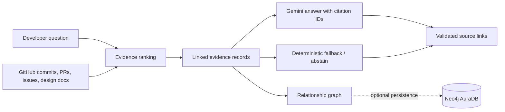

# SkillForge AI — Code Context

**Ask why the code is like this. Follow every answer back to repository evidence.**

> 🌐 **Live Application:** [https://skillforge-ai-q4tz.onrender.com](https://skillforge-ai-q4tz.onrender.com)
> 📦 **GitHub Repository:** [https://github.com/tanmayyyyayyy/SkillForge-AI](https://github.com/tanmayyyyayyy/SkillForge-AI)
> 🧪 **Test Suite:** **365 tests passing across 32 suites (100% pass rate)**

SkillForge Code Context helps developers recover the reasoning hidden in commits, pull requests, issues, and architecture notes. It is the hackathon focus of the wider SkillForge AI platform: learners can study a real project, understand its trade-offs, and explain those decisions in their own portfolio.

---

## Quick Links & Documentation

- 🏛️ [System Architecture & Specifications](docs/ARCHITECTURE.md)
- 🎬 [Code Context Demo Script](docs/DEMO_GUIDE.md)
- 📝 [Hackathon Submission Content](docs/SUBMISSION_CONTENT.md)
- 🧪 [Testing & Verification Architecture](docs/TESTING.md)
- ⚠️ [Known Limitations & Operational Notes](docs/KNOWN_LIMITATIONS.md)
- ✅ [SaarthiX Platform Submission Checklist](docs/SUBMISSION_CHECKLIST.md)

---

## The Problem

Code describes current behavior; it rarely preserves the reason behind it. A retry limit, migration delay, or compatibility flag may be explained only in an old pull request, issue, commit, or architecture decision record. Keyword search finds mentions, but it does not show which decision applies or whether later evidence changed it.

---

## The Hackathon Build

The public **Code Context** flow takes a GitHub repository and a natural-language question, then ranks recent repository evidence and returns a concise answer with source links. It loads up to 100 commits, pull requests, issues, and a repository tree; fetches up to three likely ADR/design documents; and, for the strongest matching pull requests, retrieves changed files, discussion comments, and inline review comments. It also reads comments from the strongest matching issue and extracts likely function/type names or configuration keys from available diff patches.

The answer path uses Gemini server-side when configured, with an evidence-only fallback when it is unavailable. Both paths keep citations attached. If the indexed records do not state a rationale, the product says so. The relationship view connects discussions to their pull requests, issues to referenced records, and evidence to contributors, changed files, symbols, candidate decisions, and likely incident reports. Later records that explicitly supersede earlier ones are linked as possible reversals. When Neo4j AuraDB is configured, users can persist these relationships and retrieve one-hop related evidence through graph traversal before synthesis; credentials remain server-side.

**Current MVP limits:** evidence ranking is lexical, repository history is sampled rather than fully indexed, symbol extraction is best-effort from changed patch lines, incident identification is a heuristic over GitHub issue text/labels, and confidence is conservative rather than statistically calibrated. External incident platforms and private repositories are not connected. The persistent Neo4j graph requires AuraDB Query API credentials in the server environment.

---

## Architecture Overview



The graph stores repositories, evidence records, contributors, code paths, and candidate decisions supported by explicit rationale language. Source text is treated as untrusted input in the synthesis prompt, and returned citations are checked against the retrieved evidence IDs.

---

## Existing SkillForge Career Modules

The wider SkillForge platform still includes the career-readiness modules below. They remain available under **More SkillForge tools**; Code Context is the focused hackathon entry and first-run experience.

### 1. Career Autopilot & Decision Audit Trail (`server/services/autopilotService.ts`)
- Automated career advancement engine proposing high-impact actions to close target skill gaps.
- **Strict Human-in-the-Loop Governance:** Actions marked `requiresApproval: true` can never execute automatically without explicit user review and approval.
- **Decision Audit Trail:** Timestamped, immutable log recording every approval, dismissal, and completion event with rationale.

### 2. Opportunity Match & Opportunity-to-Action (`server/services/opportunityActionService.ts`)
- Paste any live job description &rarr; extract requirements &rarr; calculate alignment against verified evidence.
- 4-quadrant alignment matrix: **Strong Matches**, **Partial Matches**, **Missing Gaps**, and **Bonus Skills**.
- **1-Click Autopilot Integration:** Click *"Add to Career Autopilot"* on missing gaps to immediately convert observations into governed career actions.

### 3. Skill Proof Lab (`server/services/skillProofLabService.ts`)
- Evaluates practical coding challenges using static test assertions, structural pattern matching, and rubric verification (with automated rule-checked and AI-reviewed modes) rather than arbitrary sandboxed code execution.
- Arbitrary untrusted student code is never executed directly; structural invariant checks verify implementations safely.
- Passing work awards verified proof credentials (`classification: 'test-verified'` or `'rule-checked'`).

### 4. Canonical Evidence Ledger (`server/services/evidenceLedger.ts`)
- Centralized, deduplicated record of demonstrated skills and supporting evidence.
- Categorized into strict verification tiers: `test-verified`, `ai-reviewed`, `rule-checked`, `human-reviewed`, and `self-reported`.
- Attached with transparent evaluation limitations and duplicate-credit prevention guards.

### 5. Evidence Graph & Recommendation Provenance (`server/services/evidenceGraphService.ts`)
- Interactive SVG directed graph visualizing how job requirements map to verified evidence.
- Clickable nodes with a provenance inspection drawer showing verification method, confidence, and timestamp.
- **Recommendation Trace:** Explains exactly *why* a particular challenge or action was recommended.

### 6. Career Twin What-If Lab (`server/services/whatIfLabService.ts`)
- Dynamic parameterized simulation modeling career trajectories based on weekly study hours (1–40h), project intensity, and timeline horizons.
- Pre-configured Career Evolution Scenarios (e.g. "Full-Stack Specialist", "AI Engineering Pivot").

### 7. Live Readiness Experiment (`server/services/experimentService.ts`)
- 9-stage guided career sprint validating end-to-end readiness under active challenge constraints.
- Stage progression and evaluation attempts persist safely across server restarts.

### 8. Career Readiness Score Engine (`server/engine/readinessEngine.ts`)
- **Formula-Driven, Explainable Calculation:**
  $$R = \min\left(100, \text{round}\left(S_{\text{coverage}} + B_{\text{assessment}} + B_{\text{project}}\right)\right)$$
  - $S_{\text{coverage}} \in [0, 50]$: Demonstrated skill coverage weighted by target role importance.
  - $B_{\text{assessment}} \in [0, 25]$: Passed server-side MCQ assessments weighted by skill importance and score.
  - $B_{\text{project}} \in [0, 25]$: Completed milestone projects and portfolio repositories with submitted links (up to 3 projects provide full bonus).
- Zero black-box predictions; per-component attribution breakdowns.
- *Disclaimer:* Readiness scores are explainable estimates based on defined role requirements and recorded evidence; they do not guarantee employment or placement.

### 9. Server-Authoritative Assessments (`server/engine/assessmentEngine.ts`)
- 9 MCQ skill assessments covering Python, React, SQL, Scikit-Learn, Docker, JavaScript, TypeScript, Pandas/NumPy, and Kubernetes.
- Answer keys never leave the server; grading appends immutable attempt history.

### 10. Server-Rendered Career Readiness PDF (`server/services/pdf/`)
- Zero-dependency, pure PDF 1.4 document generator.
- Generates official proof report directly from canonical server data (`GET /api/readiness/report/pdf`).

### 11. Dual-Mode AI Provider & Deterministic Fallback (`server/services/aiProviderStatus.ts`)
- **Primary:** Google Gemini API integration (model configurable via `GEMINI_MODEL`, default `gemini-3.8-flash`).
- **Offline Fallback:** High-fidelity Contextual Deterministic Advisory Engine.
- Automatic zero-crash failover upon upstream API timeouts or quota limits.

---

## Tech Stack

| Layer | Technology |
| :--- | :--- |
| **Frontend** | React 19, TypeScript 6, Vite 8 |
| **Styling** | Vanilla CSS Custom Properties (Dark Mode, Glassmorphic System) |
| **Routing** | React Router v7 (`react-router-dom`) with code splitting |
| **Icons** | Lucide React (`lucide-react`) |
| **Backend** | Node.js (v18+), Express 5, TypeScript (`tsx`) |
| **Auth** | JSON Web Tokens (`jsonwebtoken`) + Password Hashing (`bcryptjs`) |
| **AI Layer** | Google Gemini API + Built-in Deterministic Advisory Engine |
| **Persistence** | Transactional JSON File Store with atomic POSIX renames |
| **Decision graph** | Optional Neo4j AuraDB Query API persistence for repository, evidence, contributor, and code-path relationships |
| **Testing** | Vitest v4.1 with temporary-database isolation |
| **Linter** | Oxlint (`oxlint`) |

---

## Quick Start & Local Development

### Prerequisites
- Node.js 18+ and npm

### Installation & Run

```bash
# 1. Clone the repository
git clone https://github.com/tanmayyyyayyy/SkillForge-AI.git
cd SkillForge-AI

# 2. Install dependencies
npm install

# 3. Start development server (Express API on :5001 + Vite client on :3000)
npm run dev
```

Open **http://localhost:3000** in your browser.

### Instant Evaluator Demo Access
Click **"Explore Demo"** on the landing page to instantly authenticate with the pre-seeded evaluation profile (**Aarav Sharma**, targeting AI/ML Engineer), pre-configured with coursework, verified skills, and project milestones. No manual registration is required.

---

## Environment Configuration

SkillForge AI runs out-of-the-box in development and offline demo mode with zero configuration. Copy `.env.example` to `.env` to customize settings:

| Variable | Default Value | Purpose & Requirement |
| :--- | :--- | :--- |
| `PORT` | `5001` | Backend Express server port (Render/Railway set this dynamically). |
| `HOST` | `0.0.0.0` | Network interface binding for cloud container compatibility. |
| `NODE_ENV` | `development` | Runtime environment mode (`development` or `production`). |
| `JWT_SECRET` | *(Built-in Dev Fallback)* | **Required for Production:** 64-character secret for signing JWT auth tokens. |
| `CLIENT_ORIGIN` | `""` | Optional comma-separated list of allowed CORS origins. |
| `SKILLFORGE_DB_FILE`| `server/db/data.json`| Path to JSON database. On Render, set to `/var/data/skillforge/data.json` with Persistent Disk. |
| `GEMINI_API_KEY` | *(Optional)* | Google Gemini API key for live AI coaching and enhancement. If omitted, uses deterministic engine. |
| `GEMINI_MODEL` | `gemini-3.8-flash` | Gemini model name for live requests. |
| `AI_PROVIDER` | `gemini` | Set to `deterministic` to force offline advisory engine even if key is present. |
| `NEO4J_QUERY_URL` | *(Optional)* | HTTPS AuraDB Query API endpoint; used only by the Code Context graph sync route. |
| `NEO4J_USERNAME` / `NEO4J_PASSWORD` | *(Optional)* | Server-only credentials for AuraDB graph persistence. Never expose these as `VITE_*` variables. |
| `VITE_API_BASE_URL`| `/api` | Base URL for API requests from the frontend client. |

---

## Testing & Quality Verification

SkillForge AI maintains an isolated, non-destructive test suite:

```bash
# Run all 365 tests across 32 test suites
npm test

# Type-check both React client and Express server
npm run typecheck

# Verify production bundle compilation
npm run build

# Run code linter
npm run lint
```

> **Data Safety Guarantee:** `vitest.config.ts` preloads `server/tests/setup.ts`, which redirects all test writes to an isolated temporary file in OS temp storage. Tests **never** read or modify the real `server/db/data.json`.

---

## Production Deployment & Operational Notes

Build and deploy this branch to publish the current Code Context experience. The previously published Render deployment may still serve the earlier career-readiness build until it is redeployed.

- **Health Check Endpoint:** `GET /api/health`
- **Build Command:** `npm ci --include=dev && npm run build`
- **Start Command:** `npm start`

### Persistence Note (Render Free Tier)
Render's free tier uses ephemeral containers that reset local filesystem changes when the container enters sleep mode or redeploys. To maintain database changes across container restarts in production, attach a **Render Persistent Disk** and configure:

```bash
SKILLFORGE_DB_FILE=/var/data/skillforge/data.json
```

For evaluator convenience, clicking **"Reset Demo Data"** in the top banner instantly restores clean baseline demo data.

---

## Supported Career Tracks

| Career Role Track | Tracked Skills | Primary Focus |
| :--- | :---: | :--- |
| **AI/ML Engineer** | 11 skills | Neural Networks, PyTorch, Model Serving, MLOps |
| **Software Development Engineer** | 10 skills | Data Structures, Algorithms, System Design, OOP |
| **Full-Stack Developer** | 8 skills | React, Node.js, REST APIs, Relational Databases |
| **DevOps & Cloud Engineer** | 7 skills | Docker, Kubernetes, CI/CD, Infrastructure as Code |
| **Backend Developer** | 7 skills | Microservices, Database Optimization, Caching |
| **Frontend Developer** | 8 skills | Modern React, TypeScript, Performance, CSS Architecture |
| **Data Scientist** | 6 skills | Statistical Modeling, Classical ML, Feature Engineering |
| **Data Analyst** | 6 skills | SQL Querying, Tableau/PowerBI, Data Wrangling |

---

## Known Limitations

- **Ephemeral Cloud Storage:** On Render's free tier, filesystem changes reset when the container sleeps after 15 minutes of inactivity; persistent disk storage is documented for permanent deployments.
- **AI Latency & Offline Fallback:** Live Gemini calls can occasionally experience upstream cloud latency; the system automatically falls back to its built-in Deterministic Advisory Engine without crashing.
- **Static Challenge Verification:** Practical coding challenges in the Skill Proof Lab are evaluated against server-side static test assertions and rubric checks rather than privileged Docker-in-Docker containers.
- **Single-Node Store:** The transactional JSON store supports single-process atomic writes; horizontal multi-node scaling would require a centralized database.

For full technical details, see [docs/KNOWN_LIMITATIONS.md](docs/KNOWN_LIMITATIONS.md).

---

## Key Differentiators

- **Not a Course Reseller:** SkillForge AI diagnoses gaps, prescribes targeted actions, and verifies real competency.
- **Explainable by Design:** Every gap, readiness delta, and recommendation features a transparent formula and causal trace.
- **Offline Reliability:** Built-in Deterministic Advisory Engine guarantees full demo functionality without third-party AI keys.
- **Human-Governed Autopilot:** Career actions are never executed autonomously without student approval.
- **Evidence-Backed Progression:** Practical coding challenges and server-graded assessments verify execution beyond self-attested claims, tracking provenance on an interactive Evidence Graph.

---

## License

Built for the **SaarthiX Hackathon 2026**.
