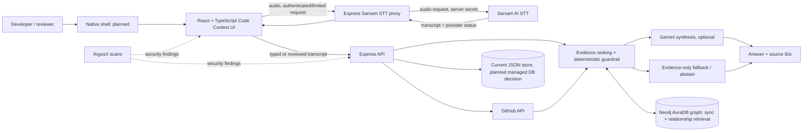

# SkillForge Code Context — Finale MVP Plan & Technical Documentation

**Event:** hackFront India Grand Finale · IIIT Delhi · 21–22 November 2026<br>
**Prototype:** SkillForge AI / Code Context<br>
**Status:** Prototype audit and proposed 22-hour delivery plan. Planned integrations below are not represented as already complete.

## 1. Finale Build Plan

### Where the prototype is today

SkillForge is a React 19 + TypeScript + Vite web application served with an Express 5 + TypeScript API. Its Code Context flow accepts public GitHub repositories, gathers a bounded set of commits, pull requests, issues, discussions and design records, answers questions with source links, and provides an evidence graph, Time Machine, pre-merge guardrail, Déjà Vu textual repeat check and ADR export. Gemini is optional and has an evidence-only fallback. The backend can proxy GitHub requests using a server-side token and optionally persist/query the Code Context graph through Neo4j AuraDB. Registration/login use bcrypt password hashes and JWTs. Data is stored in a transactional JSON file (`server/db/data.json`); the Render configuration deploys a web service and documents that the free-tier filesystem is ephemeral.

**What is real now:** repository reads use GitHub API calls; the Code Context routes validate submitted GitHub records and constrain generated answers to supplied evidence; graph sync/search is implemented for configured AuraDB; Guardrail patch matching is deterministic; ADR can use a deterministic evidence template; existing career features have server routes and tests. **What is incomplete or bounded:** history retrieval is sampled and lexical, not a complete index; incident detection is heuristic; graph persistence is optional; JSON-file storage is not a managed production database; the evaluator demo has seeded profile data and a fixed demo token; Gemini can be unavailable and then falls back. The repository has no native mobile framework or Sarvam integration today. ArgosX scans, customer interviews, market evidence, native packaging and live production validation are not evidenced in code and remain finale work. See the file-level audit in §2.

### Where we will be by 12:00 PM, 22 November

Deliver a live, evaluator-usable Code Context MVP with a focused **native app shell** around the existing React product; public-repository question answering with linked evidence; the existing guardrail, textual Déjà Vu detector, **Neo4j AuraDB-backed relationship graph**, graph/time exploration and ADR export; and **Sarvam speech-to-text in the question flow**. Configure AuraDB for the live demo, sync the retrieved repository evidence, and use graph relationships during evidence retrieval so users can trace files to decisions, PRs, issues and contributors. A user taps the microphone, speaks a question, reviews/edits the transcript, then submits that text through the same evidence retrieval flow. Typed input remains available when permission, network or provider calls fail. Neo4j and Sarvam are planned finale integrations, not claims of currently configured production services.

Complete primary and one additional segment journey; validate demand through three real target-segment conversations; record source-backed market-fit evidence; run and save the ArgosX baseline by midnight, fix critical/high findings, run and save the final scan by 11:00 AM; publish the working build and submit both reports plus a remediation log by noon. Report market, pricing, interview, deployment and scan claims only after collecting evidence.

### Users and use cases

| Segment | Their problem | Two use cases | 22-hour status target |
|---|---|---|---|
| **Primary: developers joining or maintaining an unfamiliar public codebase** | They can inspect behavior but struggle to find the historical reason and supporting evidence. | Ask why a behavior/configuration exists; check a proposed diff for linked history or possible textual repeats. | Working end to end in the live build. |
| **Additional: engineering/on-call leads** | They need historical context before changing incident-sensitive code. | Review files linked to an issue/incident; export a cited ADR for a proposed change. | At least the guardrail + cited export journey working. |
| **Additional: open-source contributors and reviewers** | They need project conventions and context before proposing a change. | Ask a repository question by voice or text; inspect the linked PR/issue trail and time order. | Voice transcript enters the same question flow; source review works. |
| **Additional: student developers** | They are learning unfamiliar repositories and need to understand how real projects evolved. | Ask why a feature or configuration exists; trace a code change to its PR, issue and contributor before using it in a class or team project. | Complete a guided sample-repository walkthrough with evidence links and beginner-friendly explanations. |

**First user and payer:** not yet validated. Problem evidence, current alternatives, switching reasons, pricing, market sizing, competitor comparison and acquisition evidence have not yet been established in this repository. Do not present a paying customer or validated demand as fact before collecting evidence. Record interview/source dates and distinguish earlier research from finale interviews.

### Partner technologies and product need

**Sarvam AI speech-to-text** is planned to let a developer ask repository questions by voice, including Indian-language or code-switched speech where the selected Sarvam model supports it. It addresses the friction of typing a precise question while exploring a codebase and provides a more accessible question-entry path. The microphone is part of the core query journey, not a standalone API demo. The transcript is shown for correction before submission. The exact model, supported languages, API contract and latency are not yet confirmed against current provider documentation and credentials.

**Neo4j AuraDB** is already supported by the prototype's graph sync/search routes and will be configured as the live finale graph store. The core flow will sync retrieved repository records into a graph connecting files and code entities with PRs, issues, decisions and contributors, then use those relationships to retrieve and display cited context for a question. The UI and answer must still show source links and abstain when the graph/history has no support. If AuraDB is unavailable, report that graph retrieval is unavailable and use only the existing evidence-backed fallback; do not imply the graph was queried. Neo4j credentials remain server-side.

### General 22-hour delivery plan

| Phase | Focus and exit evidence |
|---|---|
| **Baseline and scope** | Audit the prototype, confirm reuse rights and platform/device feasibility, capture current build/test behavior, and lock the primary user journey and API boundaries. Submit the plan by **4 PM, 21 Nov**. |
| **Core build and partner integration** | Package the existing React experience in the selected native shell if toolchain checks pass; configure Neo4j AuraDB and demonstrate graph sync plus relationship-backed evidence retrieval; integrate Sarvam STT into the question flow with editable transcript and typed fallback; complete the primary and one additional persona journey. Keep provider credentials server-side. |
| **Security baseline and remediation** | Run ArgosX against the app/API by **midnight, 21 Nov**; download the report, triage findings, fix critical/high issues first, retest, and document residual risks. Include auth, input limits, secret handling, API host/redirect restrictions and provider failure cases. |
| **Validation and hardening** | Run three target-user conversations; record assumptions, observed evidence and resulting product changes. Exercise typed/voice journeys, evidence citations, guardrail, Déjà Vu, graph/time view, ADR export, native permissions, network failures and mobile/accessibility states. Run typecheck, automated tests and production build. |
| **Release and submission** | Deploy and smoke-test the candidate; complete the final ArgosX scan and download its report by **11 AM, 22 Nov**. Finish the remediation log, confirm the evaluator can use the product, and submit the live build and required reports by **12 PM, 22 Nov**. |

**Definition of done:** By 12:00 PM on 22 November, an evaluator can launch the deployed web/native experience, ask a public-repository question by text or Sarvam voice, inspect cited evidence and a pre-merge history result, complete one second-segment use case, and review the two ArgosX reports plus a truthful remediation and market-validation record.

## 2. Repository Audit — Evidence and Limits

The following describes code found in this checkout; it does not certify that external services are currently configured or reachable.

| Area | Present in repository | Limits / missing evidence | Code evidence |
|---|---|---|---|
| Client | React 19, TypeScript, Vite, React Router; Code Context and career pages. | No native wrapper/framework dependency found; current product is a web app. | `package.json`, `src/App.tsx`, `src/pages/CodeContextPage.tsx` |
| API | Express 5 routes include auth, career modules and `/api/code-context`; health route exists. | No deployment health result asserted by source code alone. | `server/app.ts`, `server/routes/codeContext.ts` |
| GitHub retrieval | Server-side GitHub client supports bearer token, request timeout, in-flight request coalescing and user-readable errors. Client retrieves bounded public history and patches. | Not a complete repository index; no private-repository OAuth flow evidenced. | `server/services/githubClient.ts`, `server/routes/codeContext.ts`, `src/pages/CodeContextPage.tsx` |
| Decision graph | Neo4j Aura Query API sync/search can build relationships when URL and credentials are configured. | Integration is configuration-dependent; no proof current deployment has AuraDB configured. Configure it and verify sync/search during the finale. | `server/routes/codeContext.ts`, `.env.example` |
| Database | Transactional JSON file store with demo seed data. | Not PostgreSQL/MongoDB; Render free filesystem is documented as ephemeral. Multi-instance durability/concurrency needs a managed database. | `server/db/store.ts`, `server/db/data.json`, `render.yaml` |
| Authentication | Registration hashes passwords with bcrypt; login returns JWT; auth middleware verifies JWT and supports a fixed demo token. | Demo endpoint/token is intentionally evaluator-oriented; harden before production and keep demo capabilities separated. | `server/routes/auth.ts`, `server/middleware/auth.ts`, `src/context/AuthContext.tsx` |
| AI | Gemini server client records outcomes and falls back when unavailable; Code Context answer/ADR routes use provided evidence and deterministic templates. | Gemini availability is not guaranteed; Code Context ranking is lexical and history is sampled. | `server/services/geminiClient.ts`, `server/services/aiProviderStatus.ts`, `server/routes/codeContext.ts` |
| Reliability/security controls | JSON body limit, input validation in Code Context routes, GitHub request timeout, several per-IP in-memory Code Context route limits, error responses, automated Vitest suite. | In-memory limits reset on restart and do not coordinate across instances; audit headers, CORS configuration, JWT secret, storage and endpoints with ArgosX. No ArgosX reports are in this checkout. | `server/app.ts`, `server/routes/codeContext.ts`, `server/services/githubClient.ts`, `server/tests/` |
| Deployment | Render web-service blueprint builds with `npm ci --include=dev && npm run build`, starts `npm start`, and uses `/api/health`. | The blueprint says free plan and comments that its filesystem is ephemeral. Current live deployment state has not been checked as part of this repository audit. | `render.yaml`, `server/app.ts`, `package.json` |
| Partner tech | Neo4j AuraDB integration exists in Code Context. | No Sarvam or native application code/configuration found. | `server/routes/codeContext.ts`, `package.json`, repository search |
| Market validation | Product concept and use flows are described in source/docs. | No customer interview records, validated payer, pricing, market sizing source or customer count found. | `docs/SUBMISSION_CONTENT.md`, `docs/DEMO_GUIDE.md`; evidence to collect during finale |

### What works end to end in the current prototype

- The Code Context page accepts a public GitHub repository, collects a bounded history sample, asks a question, and renders an evidence answer with source links (`src/pages/CodeContextPage.tsx`). The server accepts evidence and returns either an evidence-constrained Gemini answer or a deterministic fallback (`server/routes/codeContext.ts`).
- The repository page exposes a relationship graph, Time Machine, pre-merge guardrail, deterministic Déjà Vu patch comparison and ADR generation/export. These depend on the retrieved sample and optional configured graph; they do not represent a complete historical index (`src/pages/CodeContextPage.tsx`).
- Existing career workflows have API routes and a seeded demo profile; that seed is not evidence of real user adoption (`server/db/store.ts`, `server/routes/`).
- The repository provides automated tests (`server/tests/`, `src/utils/*.test.*`) and typecheck/build scripts (`package.json`). Passing source tests should be reported with the actual run output, not assumed from the presence of tests.

### Hardcoded, heuristic, mocked or missing

- `server/db/store.ts` seeds the evaluator as **Aarav Sharma**, with a fixed demo identifier and fixed demo token returned by `server/routes/auth.ts`. Treat it as demo data, never as a real customer.
- `server/data/careers.ts`, `server/data/assessments.ts`, `server/data/defaultProjects.ts` and `server/db/data.json` include curated/static career content and sample data.
- Code Context uses lexical term scoring, heuristic rationale/incident detection and a bounded retrieval sample (`src/pages/CodeContextPage.tsx`, `server/routes/codeContext.ts`). A text match is not proof of causality or safety.
- The client’s optional providers are environment-dependent. `.env.example` describes Gemini, GitHub and Neo4j credentials; `render.yaml` documents optional credentials and persistence.
- Native packaging, Sarvam speech recognition, ArgosX reports, user interviews and verified market/payer evidence are **not present** in the code at audit time.

## 3. Target Architecture for the Finale Build



**Native shell decision:** reuse the existing React screens in a thin native container such as Capacitor, if device/toolchain validation succeeds in the first hour. The shell provides app launch, microphone permission and platform packaging; the existing Express API remains the authority for secrets, GitHub and Sarvam requests. The target OS/device must be selected after checking the team’s laptops, SDKs and evaluator requirements. If a reliable installable shell cannot be produced, keep the live web flow as the evaluator fallback and state that the native package is partial. Do not call a browser page a native app.

### First-milestone architecture decisions to validate

These are validation questions and scale-up boundaries, not claims that the prototype already implements them. Keep the current React/Express baseline during the 22-hour finale unless a measured blocker requires change; a framework/database rewrite would put the working journey at risk.

| Decision | First milestone check | Longer-term direction if evidence supports it |
|---|---|---|
| Reuse rights and inputs | Record the prototype commit/revision, licenses and permission for reused code/assets; identify any imported user data and its owner. | Maintain a component/source inventory and repeatable provenance for future imports. |
| Repository identity and version | Pin each scan to repository plus commit SHA when available; show the scanned revision and retrieval time with citations. | Versioned snapshots and re-indexing that preserve old citation references while reporting whether a source is still available. |
| Storage authority | Identify the current JSON store as prototype storage; do not migrate real accounts during the finale without an approved owner and rollback plan. | Evaluate managed PostgreSQL with versioned migrations for identities, profiles, consent, evidence, approvals and job status. Keep Neo4j a derived, replaceable graph projection, not the authority for access control. |
| Long-running import work | Measure current import duration and failure behavior; bound concurrency and cancellation. | Durable job records, idempotency keys, bounded retry/lease behavior and worker restart recovery if async ingestion becomes necessary. |
| GitHub quota/cache | Track request counts, response status and reset headers without logging tokens; document current limits. | Shared quota state across replicas, bounded cache/coalescing, capped concurrency, cancellation, and separately metered optional deep retrieval. |
| AI/provider policy | Make Gemini use explicit; keep evidence-only fallback, validate citation IDs and avoid logging content/secrets. Tell users before repository evidence leaves the server for a provider. | Provider adapters with deterministic fallback and opt-in BYOK only if a product need and secure storage model are validated. |
| Graph correctness | Label unresolved or ambiguous symbols; preserve source and resolver provenance. | Language-aware import/call graph extraction, explicit resolution state, and atomic graph snapshot replacement so incomplete indexes do not replace a usable one. |
| Retention/deletion | Decide whether voice audio is ephemeral; add consent copy and avoid retaining raw audio by default. Record any data retention behavior. | User-scoped deletion/expiry across PostgreSQL, graph projection, caches and temporary workspaces, with reconciliation and audit evidence. |

The opening baseline should include measured import request count, elapsed time, indexed-file coverage, citation availability, score/ranking repeatability on fixed fixtures, and user-visible empty/partial/error behavior. No measured baseline values are recorded in this document. Confirm staging credentials and service capacity before relying on GitHub, Neo4j, Sarvam, Gemini or a native SDK during the live demo.

### Stack and rationale

| Component | Existing / planned choice | Reason and boundary |
|---|---|---|
| UI | Existing React 19 + TypeScript + Vite; planned Capacitor wrapper | Reuse the working browser workflow; package it for device launch and microphone permissions without duplicating app logic. |
| API | Existing Node.js + Express 5 + TypeScript | Keeps third-party credentials server-side, validates requests and offers a single API to web/native clients. |
| Repository source | GitHub REST API through server proxy | Source of PR, issue, commit and patch evidence. Only cite retrieved records; handle API limits and missing patches. |
| Decision graph | Existing Neo4j AuraDB Query API, configured for the finale flow | Stores links between repository evidence, people, code paths, decisions and incidents; question retrieval uses graph relationships when AuraDB is available, with explicit status and evidence-only fallback if it is not. |
| User data | Existing JSON file for prototype; choose managed database for durable multi-user product after validation | JSON is simple for prototype but unsuitable for concurrent/multi-instance production persistence. Finale scope is migration decision/adapter only if time permits. |
| Speech | Planned Sarvam AI STT through server-side adapter | Enables voice-first repository questions; transcript must be reviewable and feed the same core query API. Confirm supported language/model and request format against provider docs. |
| Answer synthesis | Existing optional Gemini + deterministic evidence fallback | AI can phrase retrieved facts; source IDs and abstention remain mandatory. Voice transcription is separate from rationale generation. |
| Hosting | Existing Render blueprint | One service serves API and built client. Native distribution/install method is not selected yet. |
| Security scan | ArgosX baseline and final reports (planned mandatory gates) | Track findings, fix critical/high first, retain both reports and explain residual risk. |

## 4. Native App and Core User Flows

### Primary journey: ask why, follow evidence

1. Evaluator opens the installed native shell (or live web fallback) and chooses the Kubernetes sample or enters a public GitHub repository.
2. App loads a bounded sample of commits, PRs, issues, discussion and design records; UI displays what was loaded and source links.
3. User taps **Ask by voice**, grants microphone permission, speaks a question, and reviews/edits the transcript. Typing remains available.
4. Transcript/question is sent to the same repository evidence query path as typed text.
5. The API uses Neo4j relationships among retrieved repository records to find relevant context; the answer shows citations, dates/authors, confidence and related graph records. Missing rationale is explicitly reported; no unsupported answer is presented. If graph storage is unavailable, the UI identifies that state and the response uses only available cited evidence.
6. User explores the Time Machine/relationship graph, checks a change with the guardrail/Déjà Vu detector, and exports an ADR from cited records.

### Additional journey: reviewer / on-call lead

Paste a PR URL or diff; inspect changed files and linked history; review any possible textual repeat and related incident/issue; copy the evidence comment or generate an ADR. No “safe” conclusion is made from missing history or textual similarity alone.

## 5. Sarvam AI Speech-to-Text Sequence and Failure Handling

```mermaid
sequenceDiagram
  actor User
  participant App as Native React UI
  participant API as Express API
  participant STT as Sarvam STT
  participant GH as GitHub / evidence retrieval
  participant LLM as Optional Gemini
  User->>App: Tap microphone and grant permission
  App->>App: Capture bounded audio; show recording state
  App->>API: Audio + language hint + request ID
  API->>API: Validate size/type/duration; apply per-user/IP limit
  API->>STT: Forward audio using server-held credential
  alt STT succeeds
    STT-->>API: Transcript and provider metadata
    API-->>App: Transcript for user review/edit
    User->>App: Confirm or correct transcript
    App->>API: Repository question text
    API->>GH: Retrieve bounded repository evidence
    GH-->>API: Evidence records and source links
    API->>LLM: Optional evidence-only synthesis
    LLM-->>API: Answer with validated evidence IDs (or unavailable)
    API-->>App: Cited answer or deterministic fallback/abstention
  else permission/network/provider/invalid audio failure
    STT-->>API: Error, timeout, or unavailable
    API-->>App: Safe human-readable status; no audio/transcript claim
    App->>User: Retry or switch to typed question
  end
```

**Implementation safeguards:** no Sarvam secret in `VITE_*` or the native bundle; do not log raw audio or credentials; cap audio duration/bytes; use HTTPS; provide clear recording/permission state and cancel; return transcript for correction before query; bound provider timeouts and retries; never block typed input on STT availability. Provider endpoint, model, supported languages and retention terms must be confirmed from current Sarvam documentation before implementation. Keep the first release limited to the verified audio format/model rather than promise unsupported language coverage.

## 6. Backend, API and Data Model

### Existing API surface

The Express app mounts feature routers under `/api` and returns `/api/health` (`server/app.ts`). Code Context routes include answer synthesis, ADR generation, graph status, graph sync/search and the GitHub proxy; inspect the route definitions in `server/routes/codeContext.ts`. GitHub requests use `server/services/githubClient.ts`, which restricts destination origin to `api.github.com`, adds the server token when configured, applies a timeout and maps upstream errors. The Code Context routes also include input validation and in-memory per-IP throttles for selected endpoints.

### Planned voice API

Proposed endpoint: `POST /api/code-context/transcribe` (multipart or provider-supported audio payload; choose after validating Sarvam API contract). Request includes a bounded audio blob, verified content type, optional language hint and request ID. Response: `{ transcript, language?, requestId }`; failures use safe status codes/messages and never expose provider secrets or upstream raw payload. Add `POST /api/code-context/query` only if the existing answer endpoint cannot accept the transcript question cleanly. Reuse existing repository evidence validation and citation logic.

### Data entities

| Entity | Fields / relationships |
|---|---|
| User | `id`, normalized email, password hash, created time, demo flag; owns profile and private app records. |
| Repository | owner/name, default branch, last indexed time, retrieval limits/status. |
| EvidenceRecord | kind (commit/PR/issue/comment/design), source ID/URL, title/body excerpt, author/date, changed paths, related IDs, incident/rationale signals and retrieval provenance. |
| RepositorySnapshot | repository identity, commit SHA, started/completed time, coverage and analyzer versions; citations refer to this snapshot where source links permit. |
| AnalysisJob (future scale) | job ID, owner, snapshot ID, state, attempt/lease, idempotency key, progress and bounded error summary. Durable worker state is a scale-up design, not a current capability. |
| CodeEntity | repository-relative file/symbol/config key; linked to evidence through changed-file/symbol relations. |
| Decision/Incident | Candidate labels only when supported by source text; link back to source evidence. |
| VoiceRequest (ephemeral) | request ID, status and sanitized timing/provider outcome; do not persist raw audio by default. |
| SecurityFinding | ArgosX scan date, severity, location, remediation, status, residual-risk rationale and report reference. |

Current DB persistence is JSON and Code Context graph persistence is supported through Neo4j AuraDB when configured. Configure AuraDB for the finale demo and verify graph sync/search against the sample repository; do not claim the JSON store is a production-grade database. The production migration target has not been selected; avoid risky schema migration during the short MVP unless necessary for the demo. Longer term, relational storage should own identity, consent, authorization and job state; Neo4j should be a scoped projection keyed by user/repository/snapshot. Provision a replacement graph snapshot and verify it before retiring the previous usable snapshot. Apply access revocation/deletion in the authoritative store first, then retry graph/cache cleanup until reconciled.

## 7. Authentication, Security and Reliability

### Current authentication facts

`server/routes/auth.ts` registers users, hashes passwords with bcrypt and issues JWTs. `server/middleware/auth.ts` verifies tokens and recognizes the fixed evaluator demo token. Frontend API requests store/read the token from `localStorage` (`src/services/api.ts`). The demo login is intentionally seeded and must be treated separately from real-user authentication. The default JWT secret fallback is documented in source and production logs warn if it is active (`server/index.ts`, `server/middleware/auth.ts`).

### Threat model and controls

| Threat | MVP control / verification |
|---|---|
| GitHub/Sarvam/Gemini credential theft | Secrets stored only in server environment; verify built client, logs, HTML and native package contain no secret. Rotate exposed credentials. |
| Untrusted GitHub text prompt injection | Treat source text as untrusted; answer only from supplied evidence; validate citation IDs; abstain if no rationale. Review output in Gemini mode. |
| Public endpoint abuse / cost exhaustion | Request size limits, per-user/IP throttling, timeout, bounded repository/evidence/audio work; ArgosX review. Replace in-memory limits with shared limits before multi-instance deployment. |
| Malformed URL/diff/audio or oversized payload | Strict URL, content-type, path and size checks; reject unsupported input with clear error; exercise empty/invalid/large cases. |
| Unauthorized profile/data access | JWT middleware on user-specific routes; verify every endpoint enforces ownership. Separate demo identity and prevent demo reset from affecting real users. |
| XSS/unsafe source rendering | Render repository text as escaped text/Markdown-safe output; validate external links; test malicious issue/PR bodies. |
| Storage loss/corruption | Preserve atomic JSON writes; back up before migration; Render free storage is ephemeral per `render.yaml`; choose durable managed persistence for real accounts. |
| Provider/GitHub outage | Timeouts, clear retry/error states, typed question fallback, deterministic answer fallback and honest “not found” responses. Do not claim availability guarantees. |
| Audio privacy | Request consent, show recording, stop/cancel, keep audio ephemeral, avoid logging/storing audio; review Sarvam retention terms before enabling. |
| Tenant/snapshot leakage | Scope every stored/imported record by owner and repository; test two accounts importing the same repository; keep graph lookup behind authorization and do not expose another user’s private profile or job state. |
| Redirect/SSRF abuse | Allow only approved GitHub API hosts in server-side fetches; validate redirect behavior and never forward credentials to a different origin. |
| Durable deletion and retention | Retention period is not defined; test deletion/expiry across authoritative storage, graph, cache and any temporary analysis workspace before claiming complete deletion. |

**ArgosX process (required):** run baseline against the build/API and save the original report by **21 Nov 2026, 11:59 PM IST**. Triage all findings, fix critical and high severity first, rerun relevant tests and record accepted residuals with reason. Run final scan and save report by **22 Nov 2026, 11:00 AM IST**. Submit both reports and the remediation log. No ArgosX scan results are available in this document.

#### Remediation log template

| Scan | Finding ID / title | Severity | File/endpoint | Risk and reproduction | Fix / commit | Verification | Status / residual-risk reason |
|---|---|---|---|---|---|---|---|

## 8. Testing and Release Strategy

**Existing:** Vitest test suite and isolated database setup are configured (`package.json`, `vitest.config.ts`, `server/tests/setup.ts`). Typecheck and production build scripts are present. Record actual outputs and run time in the finale log.

**Finale gates:**

1. Unit tests: transcript/request validation, line matching/normalization, fallback rules, input limits, evidence citation validation, access-control scope and idempotent job transitions if jobs are introduced.
2. API integration: valid/invalid GitHub URL, nonexistent/private repository, GitHub rate limit/reset headers, timeout/network failure, oversized/empty audio, Sarvam timeout/invalid response, user auth/ownership, graph unavailable, Gemini unavailable and provider-consent behavior.
3. Journey checks on fresh users: repository -> question (typed and voice) -> editable transcript -> cited answer -> evidence/graph/time -> guardrail -> ADR export; verify two users can independently inspect the same public repository without sharing account data.
4. Native smoke: install/open on selected device, microphone permission grant/deny, background/cancel behavior, network loss, keyboard/screen-reader alternatives to graph-only interactions, mobile width, loading/empty/partial/error states and PDF/ADR rendering.
5. Regression: existing authentication/demo, primary career workflow and unaffected Code Context features. Re-run fixed fixtures to confirm repeatable citations/ranking after any analyzer or model/config change.
6. Resilience: duplicate requests, upstream throttling, retry bounds, worker pause/restart and graph replacement/deletion reconciliation when those components exist. Do not claim durable worker recovery while work is synchronous/in-memory.
7. Release: `npm run typecheck`, `npm test`, `npm run build`; deploy staging/candidate; verify health, clean evaluator journey, backup and rollback procedure. Record measured core read latency, import duration, request count, coverage and scan results after the run. Reliability targets remain proposals until measured on representative staging load.
8. Security: ArgosX baseline, fix critical/high, verify fixes, final ArgosX scan; attach both reports and completed remediation log. Also review dependency/secret scans, migrations, redirect host allowlists, content rendering, privacy/retention disclosures and user-scoped access.

## 9. Deployment and Operational Plan

The repository’s `render.yaml` defines a Render Node web service, runs the production build, starts `npm start`, and checks `/api/health`. It generates `JWT_SECRET`; Gemini, Neo4j, GitHub token and persistent disk are optional/configurable. The current blueprint uses the free plan and explicitly warns that storage is ephemeral. Before the finale, set allowlisted `CLIENT_ORIGIN`, use unique server-only secrets, confirm GitHub token authentication log without printing the token, and keep deterministic fallback usable. Deploy the web build first, verify `/api/health` and the primary flow, then package/install the native wrapper against the same API base URL. The native artifact, signing/distribution method and live deployment URL have not been confirmed.

For a future production release, deploy to staging first; keep secrets in the host’s secret manager; use redacted structured logs with request/job IDs and monitor health, queue lag and provider failures; assign an alert/release owner before launch; verify backup restore and rollback; then use a limited pilot with explicit go/no-go evidence. Define availability, read-latency, import-progress, workspace TTL, RPO/RTO and cleanup targets only after capturing a baseline and measuring representative load. No reliability targets are claimed here.

## 10. Scale Path and Persona Use Case Matrix

Scale from a sampled public-repository demo to a multi-user product only after the core flow and user need are validated: move JSON persistence to a managed transactional database with versioned migrations; add background repository ingestion and incremental webhooks; persist normalized evidence with provenance and source revision; use shared rate limits, cache and durable idempotent jobs; add repository access controls/OAuth for private repos only after security review; improve retrieval using scoped graph traversal, language-aware import/call-site resolution, coverage labels and measured ranking evaluation; add observability, retention controls, deletion reconciliation, backups and tenant isolation. Keep graph snapshots replaceable and only switch readers after a replacement is validated. Maintain citations and abstention as hard requirements. Set forecasts and performance targets only after measurement.

| Persona | Problem | Use case 1 | Use case 2 | Feature | Status at audit / finale target |
|---|---|---|---|---|---|
| Developer joining/maintaining an unfamiliar repo (primary) | Intent is scattered across source history. | Ask why a behavior exists by text/voice. | Check proposed diff against earlier decisions and export an ADR. | Code Context, Sarvam transcript entry, evidence graph, guardrail and ADR. | Existing web workflow; native + voice planned; end-to-end acceptance by noon. |
| Engineering/on-call lead | Change review needs historical incident context. | Identify files connected to retrieved issues/incidents. | Review cited history before a risky edit and share a PR comment. | File-level guardrail and evidence comment. | Guardrail exists; validate with user and improve clarity during finale. |
| Open-source contributor/reviewer | New contributors lack project-specific context. | Ask a question in a supported spoken language. | Trace the answer to PR discussion, author and date before contributing. | Public repo walkthrough, reviewed transcript, source links and Time Machine. | Typed path exists; voice and additional-segment validation planned. |
| Student developer | Real repositories are difficult to learn from when code and historical context are separated. | Understand why a feature or configuration was added. | Follow a file to the PR, issue and contributor that explain a project decision. | Guided sample walkthrough, relationship graph and evidence citations. | Include as an explicit target segment; validate the guided journey during the finale. |

**Market validation:** No customer interviews are recorded in this audit. During the finale, capture three conversations with consent, noting each person's segment, initial assumption, observed evidence and resulting product change. Do not include identifying details without permission.

The first user, payer, current alternative, switching reason, pricing hypothesis, market source, competitor comparison and first-user acquisition path are not yet validated. Add them only when supported by interview notes or named sources. Label earlier research separately from finale interviews.
